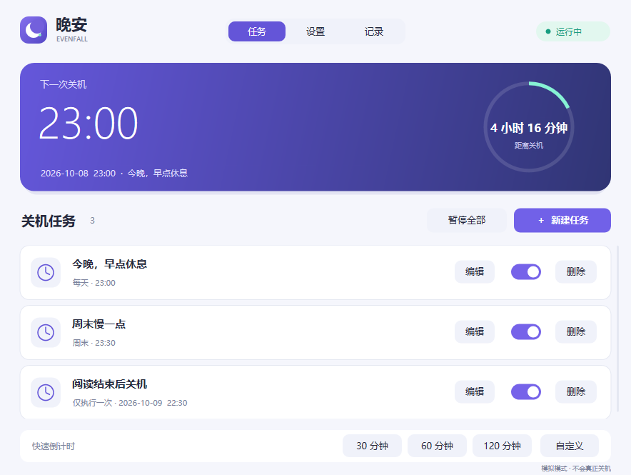
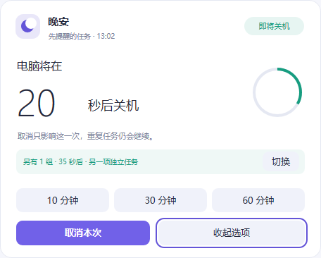

# 晚安 · 定时关机（Evenfall 1.1.0 自测预发布）

**本包按用户要求直接打包，最终功能验证由用户自行完成。此前构建的测试结果不作为本包验收结果；冷启动未登录关机尚未验收。**

Windows 10/11 64 位离线关机工具。单个 EXE、浅深色主题、托盘常驻；支持一次、按星期重复和倒计时任务。



## 下载

推荐下载 [Windows 64 位便携包](https://github.com/honina0101-boop/Scheduled-shutdown/releases/download/v1.1.0/Evenfall-1.1.0-win-x64.zip)，解压后运行 **Evenfall.exe**。也可下载 [单文件 EXE](https://github.com/honina0101-boop/Scheduled-shutdown/releases/download/v1.1.0/Evenfall.exe)，或查看 [所有版本](https://github.com/honina0101-boop/Scheduled-shutdown/releases)。GitHub 自动提供的 Source code 是源码，需要自行编译。当前发布未做代码签名。

## 未登录也能执行，登录后显示托盘

1. 把 EXE 放在固定、本地、未加密的目录，双击运行。
2. 在设置中开启 **未登录也执行任务**，确认后允许管理员设置。程序创建当前账户的 S4U 后台计划任务，不询问或保存 Windows 登录密码。
3. 开启 **登录后启动托盘界面**。登录后仅显示托盘；双击托盘或手动运行 EXE 打开主窗口，连接同一个后台。
4. 创建关机任务。未登录、注销、关闭界面均不会停止后台；登录／解锁时正在倒计时，会显示剩余时间，目标时间不会因为打开界面而延后。

两个启动设置独立，普通新用户默认关闭。手动运行仍可启动当前用户的后台进程使用软件。关闭“未登录也执行任务”只关闭后台开机启动，不结束已经运行的后台；需要停止当次运行时使用托盘的“停止后台并退出”。

**未登录或锁屏时无法操作桌面提醒，但后台仍按时执行，关机作用于整台电脑。** 普通关机允许未保存应用阻止；强制模式可能丢失未保存内容。

S4U 不能访问网络或加密文件，并受账户批处理登录、关机权限及组织策略限制。设置失败会明确报错，不会改用 SYSTEM 或保存密码。使用其他账户进行管理员授权会被拒绝，避免把后台改为其他账户运行。

## 使用与调度规则

- 支持一次任务、任意星期组合、30／60／120 分钟或自定义倒计时；可命名、编辑、停用和删除多个任务。
- 提前 60 秒提醒，可取消本次或推迟 10／30／60 分钟。相同时间合并；不同提醒组独立执行、可以切换。
- 停用持续有效，必须手动开启；取消只跳过该次计划日期。23:59 取消紧接着的每天 00:00，下一次为再下一天 00:00，不增加 24 小时冷却。
- 正常提醒保持原时间，单调时钟与系统时间均到达目标才请求关机，允许系统调度造成短暂延迟。
- 后台启动／睡眠恢复时，已过期任务跳过；尚未来到但不足一分钟则补足 60 秒提醒。仅连接或重新打开界面不会重新安排倒计时。
- 不主动唤醒电脑。暂停全部任务会持久化；恢复只处理未来任务，不补执行暂停期间错过的任务。
- 关闭主窗口进入托盘；“退出界面，后台继续”保留调度。“停止后台并退出”结束当前后台运行，保留启动设置，未来开机或手动启动仍可恢复。
- 记录区区分原计划、本次目标、实际请求时间；“已请求关机”仅表示 Windows 接受请求。旧日志缺少原计划时显示“旧版未记录”。



## 界面与后台连接

后台独占任务数据并负责保存和关机。界面通过仅限本机所属账户的命名管道连接；界面退出不影响后台。保存成功才确认操作成功，断线不会自动重发修改命令。

后台未连接时显示状态和重试入口，不能修改任务；旧组件不兼容时提示退出旧版。多个界面不会创建多个调度器。编辑期间任务被其他界面修改时拒绝覆盖，可在编辑器点击“重新载入”。

## 升级、数据与回退

升级前退出旧版及其后台副本，备份整个 `%LOCALAPPDATA%\Evenfall` 和旧 EXE，再替换固定路径的程序。启用新版后台功能时，会备份并迁移当前账户、相同程序路径的受支持旧计划任务，不处理无关任务。

任务、设置和最近 100 条记录保存在当前用户目录。1.1.0 读取格式 1／2／3，保存为 **schemaVersion 3**。旧“autostart”仅迁移为界面登录启动，不擅自开启未登录关机。回退旧版本时须先停止新版后台、停用新版后台启动入口，再恢复升级前的数据和 EXE；旧版不能读取新版格式。

保存使用临时文件、刷新和原子替换。损坏恢复及保存失败会暂停自动执行；“重试保存”成功后仍需手动恢复。普通原子备份只保留最近一份，不能替代独立升级备份。程序没有联网更新、账号或遥测。

开发节点和修改原因见 [交接记录](docs/HANDOFF.md)；验证结果见 [验证报告](docs/QA-REPORT.md)。详细本机配置及备份不放入仓库或公开下载包。

## 构建

C++20、Win32、Direct2D、DirectWrite，使用 Windows 系统组件与固定的 nlohmann/json 3.12.0。开发机需要 Python 3。

```powershell
python scripts/bootstrap.py
powershell -ExecutionPolicy Bypass -File scripts/build.ps1
```

固定版本的便携工具链只下载到项目 `.tools`，不会注册到系统。也支持 Visual Studio 2022 Build Tools 的 C++／Windows SDK／CMake：

```powershell
cmake -S . -B build-msvc -G "Visual Studio 17 2022" -A x64
cmake --build build-msvc --config Release
ctest --test-dir build-msvc -C Release --output-on-failure
python scripts/release.py --build-dir build-msvc/Release --msvc
```

静态链接运行库，调试符号单独保存，发布 EXE 强制检查不超过 5,000,000 字节。

## 开发与验证

```powershell
build\Evenfall.exe --simulate
build\Evenfall.exe --smoke-test "build\ui-smoke"
python tests/runtime_integration.py build/Evenfall.exe build/runtime-tests
build\Evenfall.exe --client-test "build\client-smoke"
python scripts/qa.py --build-dir build --exe dist/Evenfall.exe
```

`--simulate` 默认使用独立 Simulation 目录；`--smoke-test` 和 `--client-test` 强制隔离模拟。模拟后台不调用真实关机，也不修改登录启动项。独立界面测试退出后后台可能仍运行，测试控制器负责发送停止命令。

可选的 `tests/s4u_integration.py` 需要管理员权限，只创建独立模拟配置的临时 S4U 任务，检查跨进程通信和异常重启，完成后清理临时任务。它不证明冷启动停留登录界面时的真实关机已经验收。专用环境步骤见 [测试说明](docs/TESTING.md)。

入口：`--engine` 运行纯后台，`--ui` 运行界面，`--tray` 启动到托盘，`--data-dir` 指定数据目录。界面默认连接后台，后台启动入口由软件设置管理，不应再手动添加运行普通界面的非交互式计划任务。

## 发布

```powershell
python scripts/release.py --dist-dir dist/v1.1.0
python scripts/qa.py --exe dist/v1.1.0/Evenfall.exe
python scripts/release.py --dist-dir dist/v1.1.0 --reuse-exe
python scripts/publish_release.py --dist-dir dist/v1.1.0 --prepare-only
python scripts/publish_release.py --dist-dir dist/v1.1.0 --target-sha (git rev-parse HEAD)
```

用户明确要求跳过最终功能验证时，可在准备和发布命令中添加 `--candidate`，只允许发布为待验收的预发布版本，不引用旧 QA 报告。

正常发布脚本先验证已测 EXE 与 ZIP 的 SHA-256，再上传草稿，四项资产完整后公开。使用本机 Git Credential Manager 或 GH_TOKEN／GITHUB_TOKEN，不输出或保存令牌。运行中的 EXE 无法覆盖时使用独立产物目录，不强行覆盖。

## 许可证

[MIT License](LICENSE)；第三方许可见 [THIRD-PARTY-NOTICES.txt](THIRD-PARTY-NOTICES.txt)。JSON 使用 MIT；便携构建包含的 GCC 运行库适用 GCC Runtime Library Exception，相应文本包含在便携 ZIP 中。